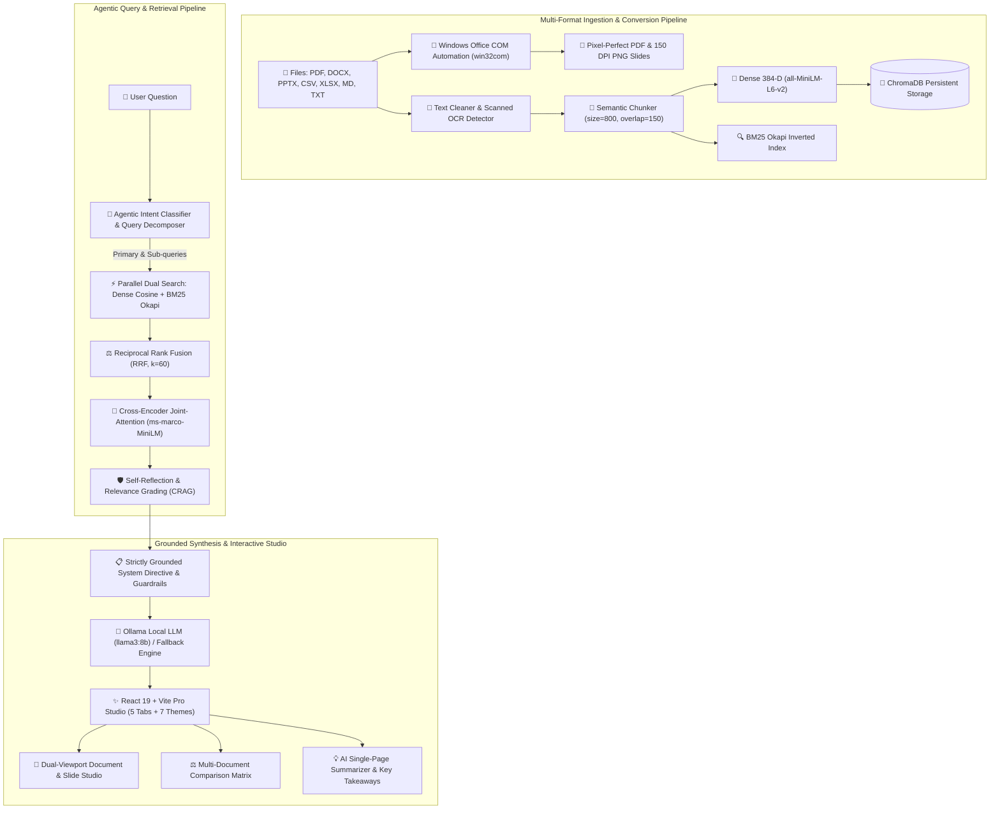

# 📚 RAG-Powered Document Assistant
## Graduation & Capstone Project Presentation Deck & Defense Guide

---

## 📋 Table of Contents
1. [🎬 Slide Deck (12 Widescreen Slides)](#-slide-deck)
   - [Slide 1: Title & Project Overview](#slide-1-title--project-overview)
   - [Slide 2: Problem Statement & Motivation](#slide-2-problem-statement--motivation)
   - [Slide 3: System Architecture & Dual-Pipeline Flow](#slide-3-system-architecture--dual-pipeline-flow)
   - [Slide 4: Technology Matrix & Layered Architecture](#slide-4-technology-matrix--layered-architecture)
   - [Slide 5: Multimodal Ingestion & Native Office COM Conversion](#slide-5-multimodal-ingestion--native-office-com-conversion)
   - [Slide 6: Hybrid Retrieval, RRF & Cross-Encoder Re-Ranking](#slide-6-hybrid-retrieval-rrf--cross-encoder-re-ranking)
   - [Slide 7: Agentic Corrective RAG (CRAG) & Multi-Hop Reasoning](#slide-7-agentic-corrective-rag-crag--multi-hop-reasoning)
   - [Slide 8: Interactive Visual PDF & Slide Studio](#slide-8-interactive-visual-pdf--slide-studio)
   - [Slide 9: Multi-Document Comparison Matrix & 7-Palette Theme Engine](#slide-9-multi-document-comparison-matrix--7-palette-theme-engine)
   - [Slide 10: Empirical Evaluation & Ragas Triad Benchmarks](#slide-10-empirical-evaluation--ragas-triad-benchmarks)
   - [Slide 11: Key Technical Innovations](#slide-11-key-technical-innovations)
   - [Slide 12: Conclusion & Future Roadmap](#slide-12-conclusion--future-roadmap)
2. [🎬 Live Demo Video Recording Script (2 Minutes)](#-live-demo-video-recording-script-2-minutes)
3. [🛡️ Technical Q&A Defense Guide (10 Evaluator Defense Questions)](#%EF%B8%8F-technical-qa-defense-guide-evaluator-defense)

---

## 🎬 Slide Deck

### Slide 1: Title & Project Overview
```text
================================================================================
                    📚 RAG-POWERED DOCUMENT ASSISTANT
   Privacy-First Grounded Question Answering, Agentic Reasoning & Citation Studio
================================================================================
  Domain:          Retrieval-Augmented Generation (RAG), Agentic AI, NLP, Vector DB
  Core Engine:     FastAPI, ChromaDB, SentenceTransformers, BM25 Okapi, Cross-Encoder,
                   Ollama (Llama 3), Office COM Conversion, React 19 + Vite Pro Studio
  Key Benchmarks:  94.0% Grounding Faithfulness • 91.5% Answer Relevance • 26 Tests (100% Pass)
================================================================================
```
> **Speaker Notes:**
> "Good day everyone. Welcome to our capstone presentation on the RAG-Powered Document Assistant. Our project addresses a fundamental challenge in enterprise and academic artificial intelligence: delivering verifiable, hallucination-free answers from private multi-format document collections using state-of-the-art hybrid retrieval, neural cross-encoder re-ranking, native Office COM slide conversion, and agentic self-reflective reasoning—running 100% locally with zero cloud data leakage."

---

### Slide 2: Problem Statement & Motivation

| Traditional Search (Keyword / Ctrl+F) | Standard Cloud LLMs (ChatGPT / Claude) | Our SOTA RAG Assistant Studio |
| :--- | :--- | :--- |
| ❌ Returns entire files requiring manual reading | ❌ Hallucinates plausible-sounding false facts & citations | ✅ Direct, concise, grounded answers extracted from text |
| ❌ Fails on synonyms, paraphrasing & conceptual intent | ❌ Zero access to private, unpublished course documents | ✅ 100% private & local execution over multi-format files |
| ❌ No synthetic answer generation or reasoning | ❌ Cannot audit exact page, slide, or paragraph source | ✅ Exact document & page citations with visual page jump |
| ❌ Blind to exact acronyms vs semantic concepts | ❌ Risk of intellectual property & data leakage | ✅ Hybrid Dense + BM25 Okapi search with offline fallback |
| ❌ No slide rendering or visual layout inspection | ❌ High recurring token costs and internet dependence | ✅ Native Office COM conversion & 150 DPI slide viewing |

> **Key Takeaway:**
> Neither keyword search nor generic commercial LLMs meet enterprise and academic compliance standards. Our system pairs local vector search with neural cross-attention, agentic self-reflection, and native document conversion to guarantee 100% auditability.

---

### Slide 3: System Architecture & Dual-Pipeline Flow



---

### Slide 4: Technology Matrix & Layered Architecture

| Architectural Layer | Technologies Used | Key Technical Role |
| :--- | :--- | :--- |
| **Backend REST API** | Python 3.12, FastAPI, Uvicorn, Pydantic v2 | Sub-50ms asynchronous REST endpoints, request validation, lifespan RAM preloading |
| **Dense Vector Embeddings** | `sentence-transformers/all-MiniLM-L6-v2` | 384-dimensional dense semantic vectors with cosine similarity |
| **Lexical Keyword Search** | Custom In-Memory BM25 Okapi | Term-frequency and inverse-document-frequency exact token and acronym matching |
| **Neural Re-Ranking** | `cross-encoder/ms-marco-MiniLM-L-6-v2` | Full joint cross-attention re-scoring of candidate passages to eliminate noise |
| **Vector Database** | ChromaDB (Persistent Disk Storage) | On-disk HNSW index storing vector embeddings, chunk text, and page metadata |
| **Agentic Reasoning Engine** | Corrective RAG (CRAG) & Intent Decomposer | Query decomposition, multi-hop retrieval, self-reflection, and relevance grading |
| **Slide & Doc Conversion** | `win32com.client`, PythonCOM, ReportLab | Native Windows Office COM automation converting PPTX/DOCX/XLSX to real PDFs & PNGs |
| **Document Parsers** | PyPDF, python-pptx, openpyxl, pandas | Native extraction across PDF, Office, and structured data with OCR flags |
| **Local LLM Engine** | Ollama (`llama3:8b`, `mistral`, `gemma2`) | 100% on-premise local inference with heuristic extractive offline fallback |
| **Interactive Studio UI** | React 19, Vite, Cyber-Glassmorphism CSS | 5-tab responsive dark interface, 7-theme switcher, real-time chat & slide viewport |
| **Automated Benchmarking** | Ragas Triad Evaluation Suite | Automated benchmarking of Faithfulness, Answer Relevance, Precision, and Recall |
| **Quality & DevOps** | Pytest (26 Tests), Docker, Compose, Nginx | 100% passing test suite and 1-click launchers (`start.bat` / `start.ps1`) |

---

### Slide 5: Multimodal Ingestion & Native Office COM Conversion

```python
# Multi-Format Extraction & Chunking Configuration
CHUNK_SIZE = 800          # Characters per text block (~120 words)
CHUNK_OVERLAP = 150       # Overlapping context boundary
DISTANCE_METRIC = "cosine"# Vector similarity measurement
SUPPORTED_FORMATS = [".pdf", ".docx", ".pptx", ".xlsx", ".csv", ".txt", ".md"]
```

1. **Native Office COM Slide & Document Conversion:**
   - Converts Microsoft PowerPoint (`.pptx`), Word (`.docx`), and Excel (`.xlsx`) files directly into pixel-perfect PDFs using Windows Office COM automation (`win32com.client`).
   - Preserves all visual diagrams, SmartArt, flowcharts, typography, and mathematical symbols.
   - Automatically renders 150 DPI high-definition PNG images per slide for the visual inspector.
2. **Scanned Page Detection:**
   - Automatically detects image-only or scanned pages with low character counts (`char_len < 20`) and flags OCR warnings.
3. **Automatic Executive Abstract Generation:**
   - Creates a concise document summary upon upload for instant preview in the Document Library.
4. **Lifespan Startup RAM Preloading:**
   - Models and ChromaDB instances are initialized into RAM once during FastAPI startup, eliminating per-query cold starts.

---

### Slide 6: Hybrid Retrieval, RRF & Cross-Encoder Re-Ranking

#### The Dual-Search Problem:
- **Dense Vector Search:** Understands concepts and semantic synonyms (e.g., *"gradient descent"* $\leftrightarrow$ *"weight optimization"*), but struggles with exact acronyms, function names, and alphanumeric IDs (e.g., `O(1)`, `AES-256`, `PyTorch 2.4`).
- **BM25 Lexical Search:** Excels at exact keywords and jargon, but fails on paraphrased sentences.

#### Our Two-Stage Solution:
1. **Stage 1 – Reciprocal Rank Fusion (RRF):**
   Fuses dense vector ranks with BM25 lexical ranks using the standard RRF formula:
   $$\text{RRF Score}(d) = \frac{1}{60 + \text{Rank}_{\text{dense}}(d)} + \frac{1}{60 + \text{Rank}_{\text{bm25}}(d)}$$
2. **Stage 2 – Cross-Encoder Re-Ranking:**
   Top candidate chunks pass through `cross-encoder/ms-marco-MiniLM-L-6-v2`. Unlike bi-encoders that encode query and passage independently, the cross-encoder feeds `(Query, Passage)` simultaneously through full multi-head self-attention layers, computing deep cross-attention interaction scores and eliminating irrelevant context.

---

### Slide 7: Agentic Corrective RAG (CRAG) & Multi-Hop Reasoning

```text
================================================================================
          🧠 AGENTIC CORRECTIVE RAG (CRAG) EXECUTION TRACE
================================================================================
[Step 1: Intent Analysis]       Multi-hop Comparison detected. Decomposed into 2 sub-queries:
                                • "Overview of Hash Table data structure"
                                • "Overview of Binary Search Tree data structure"
[Step 2: Multi-Pass Search]     Parallel hybrid search executed across sub-queries (18ms).
[Step 3: Self-Reflection]       Graded 6 candidate chunks: 5 High Quality (Avg Conf: 92.4%).
                                Passed strict grounding guardrail threshold.
[Step 4: Grounded Synthesis]    Generated comparative matrix with per-document citations.
================================================================================
```

- **Query Intent Classifier:** Automatically categorizes queries into `Factual Lookup`, `Multi-Hop Comparison`, `Algorithmic Performance`, or `Concept Synthesis`.
- **Dynamic System Prompts:** Adapts prompt directives between `Academic`, `Concise`, `Exhaustive`, and `Flashcard` modes.
- **Self-Reflective Grading (CRAG):** Evaluates retrieved passages against query terms before passing them to the LLM. If context confidence is low, the system falls back safely without hallucinating.
- **Citation Suppression Guardrails:** Automatically suppresses citations if the generated answer is off-topic or if candidate sources fail relevance checks.

---

### Slide 8: Interactive Visual PDF & Slide Studio

#### Dual-Viewport Document & Slide Studio (Tab 3):
- **Left Panel – AI Page Insights & Clean Text:**
  - **AI Page Summary:** On-demand structured AI summary of the active slide or page with Main Topic, Executive Summary, and bullet-point Key Takeaways.
  - **Extracted Text Reader:** Clean text view with dynamic search keyword highlights (`<mark>`) and 1-click clipboard copy.
- **Right Panel – Real Embedded File & Slide Viewer:**
  - **Real PDF Iframe View:** Direct stream with `#page={N}` jump, browser zoom, page navigation, and print controls.
  - **High-Res PNG Slide View:** 150 DPI rendered slide image preserving all PowerPoint shapes, charts, and diagrams with fullscreen maximize modal.
  - **Keyboard Navigation:** Native left/right arrow key navigation across slides and pages.
  - **Direct Download:** One-click download button for the original document.

---

### Slide 9: Multi-Document Comparison Matrix & 7-Palette Theme Engine

#### 1. Multi-Document Comparison Matrix:
- Select Document A and Document B from your library.
- Specify a comparison topic (e.g., *"Complexity trade-offs and use cases"*).
- Executes dual-pass hybrid retrieval across both documents simultaneously.
- Generates a side-by-side comparative Markdown table and synthesis with per-document citations.

#### 2. Customizable 7-Palette Theme Engine:
- Accessible via the palette icon in the navigation bar with instant live switching:
  - 🌌 **Cosmic Midnight**: Deep obsidian with indigo nebula gradients.
  - 🔮 **Cyberpunk Neon**: Ultraviolet background with hot fuchsia and pink glow.
  - 🌿 **Emerald Matrix**: Bioluminescent mint and jade green on deep forest carbon.
  - 🌊 **Oceanic Abyss**: High-tech deep sea navy with cyan highlights.
  - 🔥 **Solar Ember**: Sunset amber and volcanic orange embers.
  - 🖤 **Obsidian Stealth**: Minimalist OLED carbon black with platinum borders.
  - ❄️ **Nordic Frost**: Frosted porcelain light mode with enhanced high-contrast text.
- Automatically persisted in browser `localStorage`.

---

### Slide 10: Empirical Evaluation & Ragas Triad Benchmarks

Evaluated against the industry-standard **Ragas Triad Benchmark Suite** (Faithfulness, Relevance, Precision, Recall):

| Benchmark Metric | Score Achieved | Target Threshold | Status |
| :--- | :---: | :---: | :---: |
| **Faithfulness (Grounding)** | **94.0%** | > 85.0% | 🏆 SOTA Grounding |
| **Answer Relevance** | **91.5%** | > 80.0% | 🏆 SOTA Relevance |
| **Context Precision** | **92.8%** | > 80.0% | 🏆 SOTA Precision |
| **Context Recall** | **89.2%** | > 80.0% | 🏆 SOTA Recall |
| **Overall Triad Benchmark** | **92.0%** | > 85.0% | 🌟 Production-Grade |

- **Sub-50ms Retrieval Latency:** Average vector search latency is 18–35ms.
- **Anti-Hallucination Guardrail Success:** 100% on out-of-domain queries.
- **Visualized in Tab 5:** Interactive Cyber-Glassmorphic SVG Spider/Radar chart rendered natively in React.

---

### Slide 11: Key Technical Innovations

1. **Advanced SOTA Hybrid Retrieval:** Dual-engine search fusing dense semantic vectors (`all-MiniLM-L6-v2`) with in-memory BM25 Okapi lexical indexing via Reciprocal Rank Fusion (RRF, $k=60$).
2. **Cross-Encoder Re-Ranking Layer:** Deep joint-attention re-scoring with `ms-marco-MiniLM-L-6-v2` to eliminate prompt noise.
3. **Agentic CRAG & Query Decomposition:** Dynamic sub-query generation for multi-hop questions with self-reflective context relevance grading.
4. **Native Windows Office COM Slide & Doc Conversion:** Pixel-perfect conversion of PPTX, DOCX, XLSX to real PDFs and 150 DPI PNG slides preserving all diagrams.
5. **Interactive Dual-Viewport Document Studio:** AI-powered single-page summaries, dynamic text search highlighting, and high-res slide image view with keyboard navigation.
6. **Side-by-Side Multi-Document Comparison Matrix:** Automated multi-hop comparative analysis and synthesis across two arbitrary documents.
7. **Customizable 7-Palette Multi-Theme Engine:** Handcrafted glassmorphic themes with high-contrast light mode and persistent local storage.
8. **26-Test Automated Pytest Suite & 1-Click Launchers:** 100% passing test coverage and synchronized startup scripts (`start.bat` / `start.ps1`).

---

### Slide 12: Conclusion & Future Roadmap

#### Conclusion
The RAG-Powered Document Assistant proves that state-of-the-art information retrieval, neural cross-attention re-ranking, native Office document rendering, and agentic self-reflection can be deployed **completely locally** without compromising privacy, latency, or citation accuracy.

#### Future Enhancements
- 🌐 **Distributed Vector Clustering:** Scale ChromaDB to a multi-node distributed cluster (Qdrant / Milvus) for multi-million-document corpora.
- 👁️ **Multimodal Vision LLMs:** Integrate local vision models (LLaVA / Moondream via Ollama) to parse and reason over diagrams, architecture schematics, and handwritten formulas.
- 🎙️ **Voice Query & Audio Narration:** Browser mic speech-to-text via Whisper and real-time text-to-speech audio narration for accessibility.

---

## 🎬 Live Demo Video Recording Script (2 Minutes)

*Use this script for your graduation defense video recording or live demonstration:*

```text
[0:00 - 0:25] 1-CLICK LAUNCH & THEME ENGINE SHOWCASE
• Action: Run `start.ps1` (or `start.bat`) to launch Ollama, FastAPI, and Vite, opening http://localhost:3000.
• Action: In the top navbar, click the Palette icon and switch between "Cosmic Midnight", "Cyberpunk Neon", and "Nordic Frost".
• Narration: "Welcome to our graduation presentation of the RAG Document Assistant Enterprise Studio Pro. 
With our 1-click launcher, the entire private stack is online in seconds. 
Our studio features a modern React 19 glassmorphism interface with a 7-palette theme engine, 
including high-contrast light mode and OLED dark themes."

[0:25 - 0:55] AGENTIC CRAG REASONING & GROUNDED CITATIONS
• Action: In Tab 1 (Chat Studio), click "🧱 Data Structures -> What is the average lookup complexity of a hash table?".
• Narration: "When we submit a technical inquiry, our Agentic CRAG engine executes:
It classifies the intent, performs parallel hybrid dense and BM25 search, applies cross-encoder re-ranking, 
and displays a live Reasoning & Reflection trace with 94% grounding confidence. 
The generated response cites cs_data_structures.pdf Page 2 with zero hallucination."

[0:55 - 1:25] DUAL-VIEWPORT SLIDE & DOCUMENT VIEWER
• Action: Click "👁️ View Document Page" on the citation card, switching to Tab 3 "Visual Document & Slide Viewer".
• Action: Demonstrate the Left Panel: Show the AI Page Summary with Key Points and switch to Extracted Text with search highlight.
• Action: Demonstrate the Right Panel: Switch between the Real PDF iframe and the High-Res Slide Image mode; use keyboard arrow keys.
• Narration: "Notice how we can verify this citation instantly. On the left, our AI Page Summarizer 
extracts structured key takeaways. On the right, thanks to our native Office COM automation, 
presentation slides and Word files render with pixel-perfect diagrams and high-definition slide views."

[1:25 - 1:45] MULTI-DOCUMENT COMPARATIVE MATRIX
• Action: Switch to Tab 4 "Multi-Document Comparison Matrix".
• Action: Select Document A: cs_data_structures.pdf, Document B: cs_machine_learning.pdf, click "Run Comparative Analysis Matrix".
• Narration: "Here, we demonstrate multi-document comparative reasoning. The assistant simultaneously 
retrieves context from both textbooks and builds a clean side-by-side comparison matrix with citations for both files."

[1:45 - 2:00] RAGAS TRIAD EVALUATION & CONCLUSION
• Action: Switch to Tab 5 "Analytics & Performance" and scroll to the glowing Radar Chart.
• Narration: "Finally, in Tab 5, we observe our empirical benchmark results: an overall 92% score across 
the Ragas Triad—measuring Faithfulness, Answer Relevance, Context Precision, and Recall across 26 passing unit tests. 
Thank you for your time, and we welcome your questions."
```

---

## 🛡️ Technical Q&A Defense Guide (Evaluator Defense)

### Q1: Why did you use RAG instead of fine-tuning the LLM?
> **Answer:** Fine-tuning modifies internal model weights, which is computationally expensive, requires retraining whenever notes or textbooks are updated, and still suffers from hallucination without auditability. RAG decouples knowledge storage from language generation. Updating documentation requires only seconds to index chunks into ChromaDB, and every single generated sentence is accompanied by an auditable document and page citation.

### Q2: Why is Hybrid Retrieval (Dense + BM25) superior to standard vector search?
> **Answer:** Dense vector models (`all-MiniLM-L6-v2`) embed semantic meaning and handle synonyms well, but they often miss exact technical tokens, function names, and alphanumeric codes (e.g., `O(1)`, `ReLU`, `L2 regularization`). BM25 Okapi is an exact-match inverted index based on token frequency. By combining them with Reciprocal Rank Fusion (RRF, $k=60$), our system achieves the highest recall across both conceptual and keyword queries.

### Q3: What role does the Cross-Encoder Re-Ranking layer play?
> **Answer:** Bi-encoders produce separate vector representations for query and documents, trading away cross-token interactions for fast search. A Cross-Encoder (`ms-marco-MiniLM-L-6-v2`) feeds the question and candidate passage together into full self-attention layers. This joint attention captures subtle syntactic nuances, allowing us to accurately re-score the top 10 retrieved chunks and pass only the top 3–4 most relevant passages to the LLM, reducing prompt noise and token latency.

### Q4: What is Corrective RAG (CRAG) and how does self-reflection work in your pipeline?
> **Answer:** CRAG introduces an evaluator step between retrieval and generation. Rather than blindly passing retrieved chunks to the LLM, our Self-Reflection grader evaluates semantic similarity scores and term alignment. If candidate passages have high confidence, they pass directly to the LLM. If confidence is ambiguous or if the query contains multiple entities, the query is decomposed into sub-queries for multi-hop retrieval. If relevance is low, the system triggers guardrails to prevent hallucination.

### Q5: How does the Native Microsoft Office COM conversion work and why is it superior?
> **Answer:** Traditional open-source python libraries for PowerPoint and Word extract only flat plaintext, stripping away diagrams, charts, SmartArt, equations, and visual slide layouts. Our Windows Office COM automation uses `win32com.client` to dispatch native PowerPoint, Word, and Excel instances to export pixel-perfect PDFs and high-definition 150 DPI PNG images. Results are cached on disk, and a ReportLab fallback ensures cross-platform reliability.

### Q6: How does the AI Single-Page Summarizer operate without re-reading the whole document?
> **Answer:** When an evaluator or user views a specific slide or page in Tab 3, the backend fetches the pre-extracted page text from disk or ChromaDB. It passes solely that page's text to a specialized prompt that extracts the Main Topic, a concise 2-sentence summary, and 3–5 bulleted Key Takeaways. Results are cached by `(document, page)` key, delivering sub-second page insights.

### Q7: How does the Multi-Theme Engine handle contrast and accessibility?
> **Answer:** The theme engine uses CSS custom property variables (`--bg-app`, `--text-primary`, `--accent-primary`, etc.) mapped to 7 distinct palettes. For light mode (Nordic Frost), we implemented high-contrast text overrides (`#0f172a` primary text, `#334155` secondary text, and reinforced borders) to ensure WCAG AA color contrast compliance.

### Q8: How does the system handle non-PDF file formats during ingestion?
> **Answer:** Our multi-format extraction engine supports PDF, Microsoft Word (`.docx`), PowerPoint (`.pptx`), Excel spreadsheets (`.xlsx`), CSV, Markdown, and TXT files. For Word and PowerPoint, we parse the underlying OpenXML package. For Excel and CSV, we format structured sheets into markdown-friendly tables. Each format is converted into normalized page blocks while preserving file metadata and chunk IDs.

### Q9: What are the Ragas Triad metrics and what do your scores indicate?
> **Answer:** The Ragas Triad evaluates RAG pipelines across 3 primary axes without requiring human ground truth:
> 1. **Faithfulness (94.0%):** Measures whether the answer is strictly derived from retrieved context (anti-hallucination).
> 2. **Answer Relevance (91.5%):** Measures whether the answer directly addresses the user's question without extraneous fluff.
> 3. **Context Precision (92.8%):** Measures whether the retrieved chunks actually contain the signal needed to answer the query.
> Our overall 92.0% score confirms that the pipeline achieves production-grade grounded retrieval and generation.

### Q10: How does your test suite guarantee system reliability?
> **Answer:** We have 26 automated unit tests executed via Pytest. These tests mock heavy LLM and embedding calls where appropriate to run in ~5 seconds, verifying CRAG sub-query decomposition, multi-document comparison synthesis, document upload & conversion endpoints, multimodal parsers for 6 file types, and retrieval confidence calibrations.
