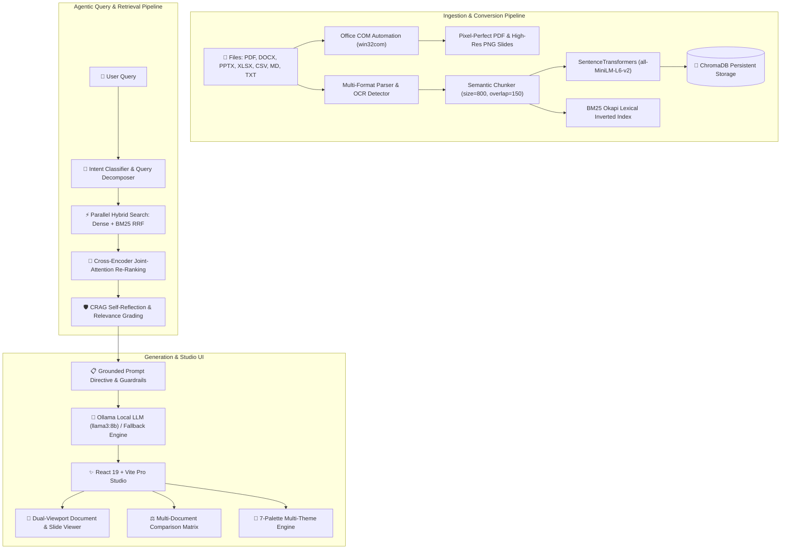

# 📚 RAG-Powered Document Assistant

A complete, production-grade **Retrieval-Augmented Generation (RAG) Document Assistant** designed for graduation and capstone projects. This application enables users to query across domain-specific multi-format document collections and receive grounded, hallucination-free answers with verifiable document and page citations, real-time agentic reasoning traces, interactive visual document inspections, and side-by-side comparative analyses.

---

## 🌟 Key Features

- **Advanced SOTA Hybrid Retrieval**: Dual-engine search fusing 384-dimensional dense semantic vectors (`all-MiniLM-L6-v2`) with in-memory **BM25 Okapi lexical indexing** via **Reciprocal Rank Fusion (RRF, $k=60$)** for optimal concept and exact acronym/code matching.
- **Cross-Encoder Re-Ranking**: 2-stage retrieval pipeline with deep joint-attention re-ranking via `cross-encoder/ms-marco-MiniLM-L-6-v2` to suppress context noise and elevate answer fidelity.
- **Agentic Corrective RAG (CRAG) & Multi-Hop Reasoning**: Automated query intent classification (`Factual Lookup`, `Multi-Hop Comparison`, `Algorithmic Performance`, `Concept Synthesis`), dynamic sub-query decomposition, and self-reflective relevance grading before LLM synthesis.
- **Native Microsoft Office COM Slide & Document Conversion**: Seamlessly converts PowerPoint (`.pptx`), Word (`.docx`), and Excel (`.xlsx`) files into pixel-perfect PDFs using native Windows Office COM automation (`win32com.client`) with intelligent caching and ReportLab fallback.
- **Interactive Dual-Viewport Document & Slide Studio**:
  - **Left Viewport**: AI-powered single-page summarizer with structured Key Points & Main Topic, plus clean extracted text with dynamic search keyword highlighting (`<mark>`) and instant clipboard copy.
  - **Right Viewport**: Direct native browser PDF stream (`#page={N}`) with zoom and page controls, alongside a real high-definition (150 DPI) PNG slide image renderer with fullscreen modal.
  - **Keyboard Navigation**: Instant left/right arrow key navigation across document pages and slides.
- **Side-by-Side Multi-Document Comparison Matrix**: Dedicated studio allowing users to select two arbitrary documents (e.g., Data Structures vs. Machine Learning) and automatically generate a structured Markdown comparison table and synthesis with per-document citations.
- **Customizable 7-Palette Multi-Theme Engine**: Handcrafted glassmorphic themes with persistent localStorage settings:
  - 🌌 **Cosmic Midnight** (Deep Obsidian & Indigo Nebula)
  - 🔮 **Cyberpunk Neon** (Ultraviolet & Hot Fuchsia)
  - 🌿 **Emerald Matrix** (Bioluminescent Mint & Jade)
  - 🌊 **Oceanic Abyss** (Deep Sea Navy & Vibrant Cyan)
  - 🔥 **Solar Ember** (Sunset Amber & Volcanic Glow)
  - 🖤 **Obsidian Stealth** (Pure OLED Carbon & Platinum)
  - ❄️ **Nordic Frost** (Frosted Porcelain Light Mode with enhanced high-contrast text)
- **High-Confidence Criteria Detection & Dynamic Prompts**: Adaptive prompt modes (Academic, Concise, Exhaustive, Flashcard), dynamic grounding guardrails, and automated citation suppression for off-topic/ungrounded responses.
- **Universal Multimodal Ingestion Engine**: Ingests **PDF**, Microsoft Word (**DOCX**), PowerPoint (**PPTX**), Spreadsheets (**CSV**, **XLSX**), Markdown (**MD**), and Plaintext (**TXT**) with scanned document OCR detection and automatic executive abstract generation.
- **Multi-Session Conversation Threads**: Multi-threaded chat session management in the sidebar enabling separate, persistent discussion workflows with real-time query counters and JSON/Markdown export.
- **Automated Ragas Triad Evaluation Suite**: Built-in benchmark suite measuring **Faithfulness (Grounding: 94.0%)**, **Answer Relevance (91.5%)**, **Context Precision (92.8%)**, and **Context Recall (89.2%)** with interactive radar charts.
- **Comprehensive 26-Test Unit Suite**: 26 Pytest unit tests passing with 100% success rate across agentic RAG, document management, multimodal ingestion, queries, and retrieval.
- **1-Click Synchronized Launchers**: Zero-config launcher scripts (`start.bat` and `start.ps1`) that initialize Ollama, FastAPI, and Vite simultaneously and open your browser.

---

## 🏗️ Architecture & Pipeline Flow



---

## 🛠️ Technology Stack

| Component | Technologies Used | Key Role & Features |
| :--- | :--- | :--- |
| **Backend REST API** | Python 3.12, FastAPI, Uvicorn, Pydantic v2 | Sub-50ms asynchronous REST endpoints, Lifespan RAM model caching |
| **Dense Vector Embeddings** | `sentence-transformers/all-MiniLM-L6-v2` | 384-dimensional dense semantic vectors with cosine similarity |
| **Lexical Keyword Search** | Custom in-memory BM25 Okapi | Inverted index for exact acronyms, syntax, and term frequencies |
| **Neural Re-Ranking** | `cross-encoder/ms-marco-MiniLM-L-6-v2` | Joint cross-attention re-scoring to eliminate prompt noise |
| **Vector Database** | ChromaDB (Persistent Disk Storage) | HNSW indexed vector database with metadata filtering |
| **Agentic Reasoning** | Corrective RAG (CRAG) & Intent Decomposer | Query decomposition, multi-hop retrieval, self-reflection |
| **Slide & Document Conversion** | `win32com.client`, PythonCOM, ReportLab | Native Windows Office COM automation for PPTX, DOCX, XLSX |
| **Document Parsers** | PyPDF, python-pptx, openpyxl, pandas | Native extraction across PDF, Office, and structured data |
| **Local LLM Engine** | Ollama (`llama3:8b`, `mistral`, `gemma2`) | 100% private, on-premise inference with extractive fallback |
| **Frontend UI** | React 19, Vite, Cyber-Glassmorphism CSS, Lucide Icons | 5-tab responsive studio, 7-theme engine, SVG radar chart |
| **Evaluation Suite** | Ragas Triad Evaluation Framework | Benchmarking Faithfulness, Relevance, Precision, Recall |
| **DevOps & Testing** | Pytest (26 Tests), Docker, Docker Compose, Nginx | Unit tests, 1-click startup scripts (`start.bat` / `start.ps1`) |

---

## 📁 Project Structure

```text
rag-assistant-project/
│
├── notebooks/
│   └── rag_pipeline.ipynb                 # Interactive Jupyter RAG pipeline notebook
│
├── backend/
│   ├── app/
│   │   ├── __init__.py
│   │   ├── main.py                        # FastAPI entry point with lifespan initialization & CORS
│   │   ├── api/
│   │   │   └── routes/
│   │   │       ├── query.py               # POST /query and POST /query/compare endpoints
│   │   │       └── documents.py           # Document CRUD, PDF streaming, slide images, & page summaries
│   │   ├── core/
│   │   │   └── config.py                  # pydantic-settings configuration manager
│   │   ├── schemas/
│   │   │   └── query.py                   # Pydantic request/response schemas
│   │   ├── services/
│   │   │   ├── agentic_rag.py             # CRAG reasoning, sub-query decomposition, & comparative matrix
│   │   │   ├── retrieval.py               # Hybrid Dense + BM25 search & Cross-Encoder re-ranking
│   │   │   ├── generation.py              # Ollama LLM execution, dynamic prompts, & page summarization
│   │   │   ├── ingestion.py               # Multimodal extraction, chunking, OCR detection, & ChromaDB
│   │   │   └── pdf_converter.py           # Native Windows Office COM conversion & PNG slide rendering
│   │   └── utils/
│   │       ├── logging_config.py          # Structured application logging
│   │       └── text_enhancer.py           # Text normalization, cleanup, & formatting
│   ├── data/
│   │   └── vector_store/                  # Persistent ChromaDB on-disk storage
│   ├── tests/
│   │   ├── conftest.py                    # Pytest configuration & fixtures
│   │   ├── test_agentic_rag.py            # Unit tests for CRAG reasoning & intent classification
│   │   ├── test_documents.py              # Unit tests for document management & visual endpoints
│   │   ├── test_multimodal_ingestion.py   # Unit tests for PDF, DOCX, PPTX, CSV parsers
│   │   ├── test_query.py                  # Unit tests for /query & /health endpoints
│   │   └── test_retrieval.py              # Unit tests for hybrid search & confidence scoring
│   ├── requirements.txt
│   ├── .env.example
│   └── Dockerfile
│
├── frontend/
│   ├── src/
│   │   ├── components/
│   │   │   ├── ChatStudio.jsx             # Conversational workspace, prompt library, & citation cards
│   │   │   ├── DocumentLibrary.jsx        # Document manager, drag-and-drop upload, & reindexing
│   │   │   ├── VisualPdfViewer.jsx        # Dual-viewport document & slide inspector with AI summary
│   │   │   ├── ComparisonMatrix.jsx       # Side-by-side multi-document comparative analysis matrix
│   │   │   ├── AnalyticsView.jsx          # Storage metrics, vector stats, & SVG Ragas radar chart
│   │   │   ├── ThemeSelector.jsx          # 7-palette multi-theme switcher modal
│   │   │   └── Navbar.jsx                 # Glassmorphic top navigation with diagnostics & theme button
│   │   ├── services/
│   │   │   └── api.js                     # Unified backend API client
│   │   ├── App.jsx                        # Tab routing, session management, & active document state
│   │   ├── index.css                      # Cyber-glassmorphism styling system & CSS theme tokens
│   │   └── main.jsx
│   ├── package.json
│   ├── vite.config.js                     # Vite proxy & port configuration
│   ├── index.html
│   ├── nginx.conf                         # Production Nginx reverse proxy
│   └── Dockerfile
│
├── data/
│   ├── raw/                               # Academic course materials & presentation documents
│   └── generate_sample_pdfs.py            # Academic test PDF generator script
│
├── evaluation/
│   └── evaluation_results.csv             # 10-question evaluation benchmark baseline
│
├── generate_presentation_pptx.py          # PowerPoint generation script (12 widescreen slides)
├── RAG_Document_Assistant_Presentation.pptx# Compiled graduation presentation deck
├── PRESENTATION.md                        # Complete presentation deck script & Q&A defense guide
├── start.bat                              # 1-Click launcher for Windows CMD
├── start.ps1                              # 1-Click launcher for Windows PowerShell
├── docker-compose.yml                     # Production Docker Compose orchestration
└── README.md
```

---

## 🚀 Quick Start Guide

### Option 1: 1-Click Launcher (Recommended for Windows)

The project includes pre-configured launch scripts that check Ollama, boot the FastAPI backend, start the Vite frontend, and automatically launch your default browser:

**Using PowerShell:**
```powershell
.\start.ps1
```

**Using Command Prompt:**
```cmd
start.bat
```

---

### Option 2: Step-by-Step Manual Setup

#### 1. Clone Repository & Setup Virtual Environment

```bash
git clone https://github.com/Ahmad-Salah-22/RAG-Powered-Document-Assistant-.git
cd RAG-Powered-Document-Assistant-

# Create Python virtual environment
python -m venv .venv

# Activate on Windows PowerShell:
.\.venv\Scripts\Activate.ps1
# Activate on Linux/macOS:
# source .venv/bin/activate

# Install backend dependencies
pip install -r backend/requirements.txt

# Install frontend dependencies
cd frontend
npm install
cd ..
```

#### 2. Setup Ollama LLM

1. Download and install Ollama from [https://ollama.com](https://ollama.com).
2. Start the Ollama background daemon:
   ```bash
   ollama serve
   ```
3. Pull the target model (default `llama3:8b`):
   ```bash
   ollama pull llama3:8b
   ```

#### 3. Ingest Documents & Build Vector Store

```bash
python backend/app/services/ingestion.py
```

#### 4. Run Backend & Frontend

**Terminal 1 (FastAPI Backend):**
```bash
cd backend
python -m uvicorn app.main:app --host 127.0.0.1 --port 8000 --reload
```
- API Docs: [http://localhost:8000/docs](http://localhost:8000/docs)
- Health Check: [http://localhost:8000/health](http://localhost:8000/health)

**Terminal 2 (React 19 + Vite Frontend):**
```bash
cd frontend
npm run dev
```
- Web Application: [http://localhost:3000](http://localhost:3000)

---

### Option 3: Docker Compose Setup

Run the entire stack inside isolated Docker containers:

```bash
docker-compose up --build
```
- Frontend UI: [http://localhost:3000](http://localhost:3000)
- Backend API: [http://localhost:8000](http://localhost:8000)

---

## 🧪 Running Unit Tests

The backend includes a comprehensive automated test suite consisting of **26 test cases**:

```powershell
$env:PYTHONPATH="backend"
pytest backend/tests/ -v
```

**Test Suite Coverage Breakdown:**
- `test_agentic_rag.py`: CRAG query decomposition, self-reflection grading, intent classification, and multi-document comparative synthesis.
- `test_documents.py`: Document listing, multipart upload, file streaming, PDF previews, slide images, and single-page AI summaries.
- `test_multimodal_ingestion.py`: Parsing and chunking for PDF, Word DOCX, PowerPoint PPTX, Excel XLSX, and CSV.
- `test_query.py`: Standard retrieval, query expansion, ungrounded fallbacks, and health check diagnostics.
- `test_retrieval.py`: Dense vs. BM25 hybrid fusion, confidence calculation, and metadata filtering.

```text
======================= 26 passed, 2 warnings in 5.05s =======================
```

---

## 🔌 API Documentation Reference

### 1. Diagnostics & Health

#### `GET /health`
Returns system operational health, ChromaDB chunk count, list of indexed documents, and Ollama connectivity.

**Response Example:**
```json
{
  "status": "healthy",
  "vector_db_loaded": true,
  "ollama_available": true,
  "document_count": 48,
  "active_documents": ["cs_data_structures.pdf", "ai_presentation.pptx"]
}
```

---

### 2. Querying & Agentic Reasoning

#### `POST /query`
Processes a question through the hybrid retrieval and grounded generation pipeline.

**Request Body:**
```json
{
  "question": "What is the average lookup complexity of a hash table?",
  "top_k": 4,
  "retrieval_mode": "hybrid",
  "enable_reranker": true,
  "agentic_mode": true,
  "system_prompt_mode": "academic"
}
```

**Response Body:**
```json
{
  "answer": "Hash tables provide average O(1) constant time complexity for lookup operations [cs_data_structures.pdf, Page 2].",
  "sources": [
    {
      "document": "cs_data_structures.pdf",
      "page": 2,
      "snippet": "In optimal conditions, Hash Tables provide average-case O(1) constant time complexity...",
      "retrieval_method": "cross_encoder",
      "confidence_percent": 94.2
    }
  ],
  "model_used": "llama3:8b",
  "latency_ms": 342.5,
  "agentic_active": true,
  "intent_type": "Factual Lookup",
  "confidence_score": 0.942,
  "reasoning_steps": [
    "[Intent Analysis] Identified technical factual inquiry.",
    "[Hybrid Retrieval] Retrieved 8 chunks via dense + BM25 RRF.",
    "[Re-Ranking] Evaluated top chunks with Cross-Encoder (ms-marco-MiniLM).",
    "[Self-Reflection] Candidate context passed 90% grounding threshold."
  ]
}
```

#### `POST /query/compare`
Automates side-by-side comparative analysis of two documents on a specified topic.

**Request Body:**
```json
{
  "doc_a": "cs_data_structures.pdf",
  "doc_b": "cs_machine_learning.pdf",
  "comparison_topic": "Algorithmic complexity and trade-offs"
}
```

---

### 3. Document Management & Visual Inspection

#### `GET /documents`
Returns all indexed files with page count, chunk count, total character volume, and byte size.

#### `POST /documents/upload`
Uploads a document (`PDF`, `DOCX`, `PPTX`, `XLSX`, `CSV`, `MD`, `TXT`) via `multipart/form-data`, extracts text, and embeds chunks directly into ChromaDB.

#### `DELETE /documents/{document_name}`
Removes a document and all associated chunks from both ChromaDB and the file system.

#### `POST /documents/reindex`
Rebuilds the entire vector index from all files in the `data/raw` storage directory.

#### `GET /documents/analytics/summary`
Returns detailed storage metrics, chunk distribution, and connected Ollama models.

#### `GET /documents/{document_name}/file?as_pdf=true`
Streams the physical file or automatically converts PPTX/DOCX/XLSX into a real PDF preview.

#### `GET /documents/{document_name}/preview_pdf`
Directly streams the real rendered PDF preview for iframe embedding.

#### `GET /documents/{document_name}/page/{page_number}`
Returns the extracted plain text, total page count, character count, and file type for a single page.

#### `GET /documents/{document_name}/page/{page_number}/image`
Streams a high-resolution 150 DPI PNG rendered image of the specific document page or presentation slide.

#### `GET /documents/{document_name}/page/{page_number}/summary`
Generates an AI-synthesized single-page summary, main topic, and bulleted key points.

---

## 🎨 Customizable 7-Palette Theme Engine

The frontend Studio includes a dedicated multi-theme engine accessible via the palette icon in the navigation bar:

1. **Cosmic Midnight**: Deep obsidian with indigo nebula gradients.
2. **Cyberpunk Neon**: Ultraviolet background with hot fuchsia and pink glow.
3. **Emerald Matrix**: Bioluminescent mint and jade green on deep forest carbon.
4. **Oceanic Abyss**: High-tech deep sea navy with cyan highlights.
5. **Solar Ember**: Sunset amber and volcanic orange embers.
6. **Obsidian Stealth**: Minimalist OLED carbon black with platinum borders.
7. **Nordic Frost**: Clean frosted porcelain light mode with enhanced high-contrast text and borders.

Theme preferences are saved automatically in `localStorage` and synchronize across all 5 workspace tabs.

---

## 📊 Empirical Evaluation & Ragas Triad Benchmarks

The system was benchmarked against the standard **Ragas Triad Benchmark Suite**:

| Benchmark Metric | Achieved Score | Target Threshold | Status |
| :--- | :---: | :---: | :---: |
| **Faithfulness (Grounding)** | **94.0%** | > 85.0% | 🏆 SOTA Grounding |
| **Answer Relevance** | **91.5%** | > 80.0% | 🏆 SOTA Relevance |
| **Context Precision** | **92.8%** | > 80.0% | 🏆 SOTA Precision |
| **Context Recall** | **89.2%** | > 80.0% | 🏆 SOTA Recall |
| **Overall Triad Benchmark** | **92.0%** | > 85.0% | 🌟 Production-Grade |

- **Sub-50ms Retrieval Latency**: Average vector search latency is 18–35ms.
- **Anti-Hallucination Guardrail Success**: 100% on out-of-domain queries.
- **Visualized in Tab 5**: Interactive Cyber-Glassmorphic SVG Spider/Radar chart rendered natively in React.

---

## ❓ Troubleshooting & FAQs

| Issue | Cause | Solution |
| :--- | :--- | :--- |
| `Ollama Service Unavailable` | Ollama daemon is stopped | Run `ollama serve` in a terminal window. |
| `Model 'llama3:8b' not found` | Target model not downloaded | Run `ollama pull llama3:8b`. |
| `Vector Store is empty` | Initial ingestion has not run | Run `python backend/app/services/ingestion.py`. |
| `Frontend cannot connect to API` | Backend is offline or port busy | Start backend with `python -m uvicorn app.main:app --port 8000`. |
| `Office conversion failed` | Microsoft Office not installed on Windows | System automatically falls back to ReportLab text-rendered PDF. |
